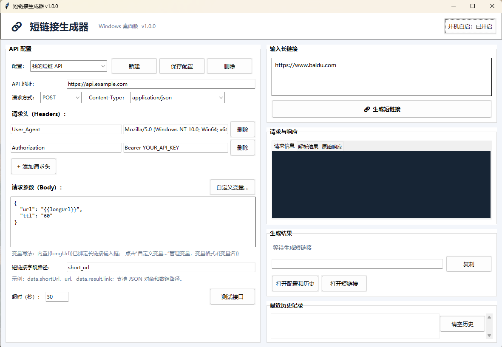

# 短链接生成器（Windows 独立 EXE 版）

## 已实现功能
- 自定义变量：可添加、编辑、删除变量；变量随 API 配置保存。
- 请求头可添加和删除；支持多套 API 配置。
- 关闭窗口或最小化时收纳到 Windows 右下角通知区域图标。
- 托盘菜单可恢复窗口或彻底退出。
- 当输入相同的长链接生成短链接时，会自动删除旧的历史记录，并将最新的结果置顶显示。
- 支持一键清除所有本地历史记录。
- 顶部按钮可开启/关闭开机自启（写入当前用户的 Windows 启动文件夹）。
- 单文件 EXE：日常使用只需双击 `ShortLinkGenerator.exe`，无需安装 Python 或其他组件。
- 配置和历史保存在 `%APPDATA%\\ShortLinkGenerator`。

## 安全提醒
API 密钥会保存在本机 `%APPDATA%\\ShortLinkGenerator\\profiles.json` 中，请勿分享含真实密钥的配置文件，请仅配置可信的 API 地址。

